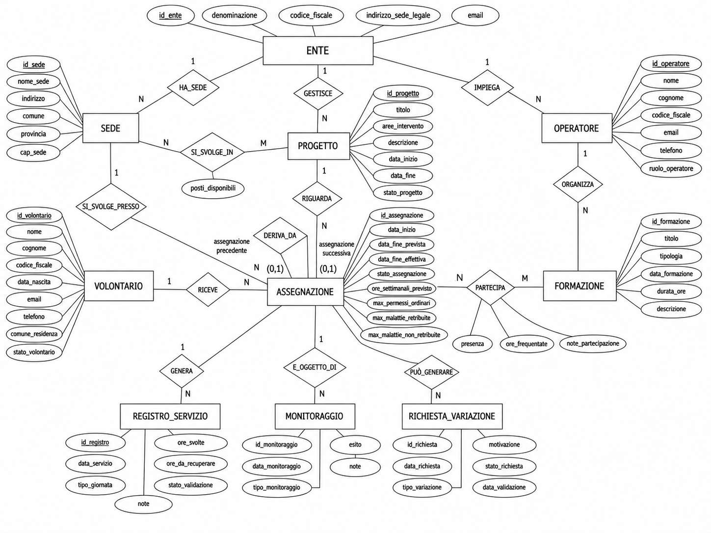

# DB Servizio Civile

Database Oracle per la gestione amministrativa del Servizio Civile: enti, sedi, progetti, volontari, assegnazioni, registro di servizio, formazione, monitoraggi e variazioni di percorso. Le regole di business sono applicate direttamente dal database tramite vincoli, trigger e procedure PL/SQL.



## Funzionalità

- **Anagrafiche**: enti, sedi, operatori (OLP, coordinatori, amministrativi), volontari.
- **Progetti e posti**: progetti collegati alle sedi con posti disponibili.
- **Assegnazioni**: percorso del volontario con storico delle variazioni (sede/progetto) e controllo delle sovrapposizioni.
- **Registro di servizio**: ore svolte, permessi e malattie con limiti configurabili; decadenza automatica al superamento.
- **Formazione e monitoraggio**: eventi formativi, partecipazioni, monitoraggi iniziali/intermedi/finali.
- **Sicurezza**: tre ruoli con privilegi minimi (amministratore, operatore, volontario).

Esempi di interrogazione (posti liberi, ore svolte, permessi residui...) in [sql/07_queries/esempi.sql](sql/07_queries/esempi.sql). Elenco completo delle regole in [docs/regole_di_business.md](docs/regole_di_business.md).

## Requisiti

- Oracle Database 12c o superiore (es. Oracle XE)
- SQL*Plus o SQLcl
- Un utente/schema con i privilegi `CREATE TABLE`, `SEQUENCE`, `VIEW`, `PROCEDURE`, `TRIGGER`, `ROLE`

## Installazione

Dalla radice del repository:

```bash
sqlplus utente/password@//host:1521/servizio @install.sql
```

Per rimuovere tutto: `@uninstall.sql`.

Se non hai un'istanza Oracle, ne puoi avviare una locale con Docker (`docker compose up -d --wait`, utente `sc`, servizio `FREEPDB1`, porta 1521; credenziali in `docker-compose.yml`, solo per uso locale).

## Test

```bash
docker compose up -d --wait
scripts/run-tests.sh
```

Lo script installa il database nel container e lancia `tests/test_vincoli.sql` (19 casi: rifiuto delle operazioni non valide, esito delle procedure, decadenza automatica), poi esegue un `ROLLBACK`. Gli stessi passi girano in CI a ogni push ([workflow](.github/workflows/ci.yml)). Testato su Oracle Database Free 23ai.

## Struttura

```text
.
├── install.sql / uninstall.sql
├── docker-compose.yml        Oracle Free per sviluppo locale
├── scripts/run-tests.sh      installazione + test in container
├── .github/workflows/ci.yml  CI
├── sql/
│   ├── 01_schema/        tabelle e indici
│   ├── 02_seed/          dati di esempio (fittizi)
│   ├── 03_procedures/    procedure PL/SQL
│   ├── 04_triggers/      vincoli applicativi
│   ├── 05_views/         viste
│   ├── 06_security/      ruoli e privilegi
│   └── 07_queries/       query di esempio (sola lettura)
├── tests/                test dei vincoli
└── docs/                 relazione, diagrammi, regole di business
```

## Documentazione

- [Regole di business](docs/regole_di_business.md)
- [Relazione completa (PDF)](docs/relazione.pdf): documento di progetto della versione accademica originale (Università Parthenope, corso di Basi di Dati e Laboratorio). Dopo la consegna gli script sono stati rivisti (ruoli al posto degli utenti, trigger unificati, sequenze, indici): per lo stato attuale fanno fede il codice e il [CHANGELOG](CHANGELOG.md).
- Diagrammi: [ER](docs/diagrammi/diagramma_er.png) · [relazionale](docs/diagrammi/diagramma_relazionale.png) · [casi d'uso](docs/diagrammi/diagramma_casi_uso.png)

## Dati di esempio

I dati in `sql/02_seed/` sono interamente fittizi (nomi, codici fiscali ed e-mail inventati). Il seed viene caricato con i trigger attivi, quindi ogni installazione ne verifica la coerenza. Gli ID inferiori a 1000 sono riservati al seed; le sequenze generano da 1000 in poi.

## Licenza

[MIT](LICENSE)
