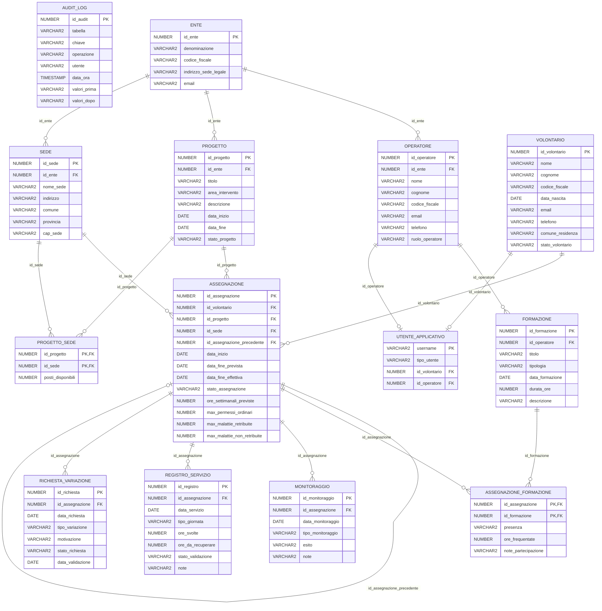

# Diagramma entità-relazione

> File generato da `scripts/genera-documentazione.sh` a partire dal catalogo del database.
> Non modificarlo a mano. Descrizione di tabelle e colonne in [dizionario_dati.md](dizionario_dati.md).

